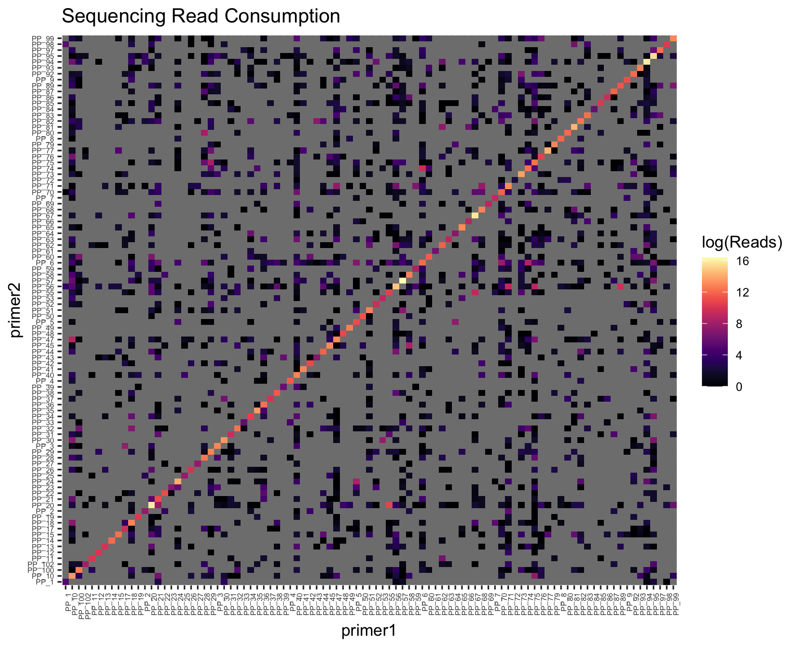
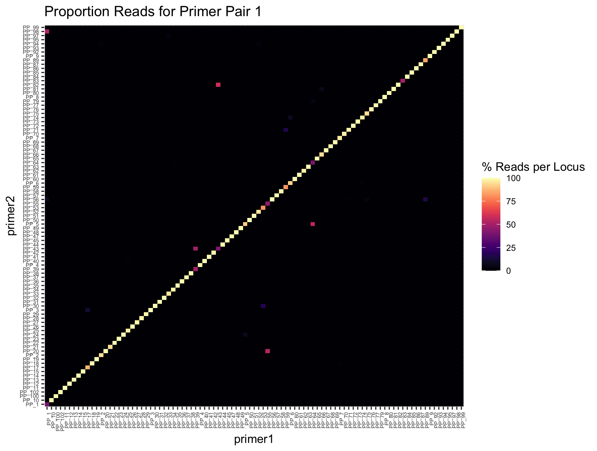
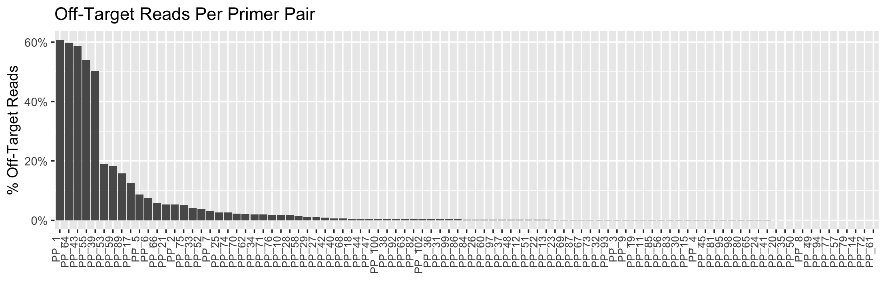

# Tabulating Realized Dimer Loads

So, you've optimized a panel, ran lab testing, and now you're wondering how to evaluate cumulative dimer loads and on-target rates. This tool supports the testing/evaluation process.

## Inputs
This tool uses outputs from the **GTseq_Primer-Interaction-Test.pl** script from Nate Campbell's [GTseq-Pipeline](https://github.com/GTseq/GTseq-Pipeline). Here's the steps I use to run this step:

### Inputs / set up
1. You'll need your demultiplexed Illumina sequencing data. It should live within a working directory with the structure: `${OUTPUT_DIR}/illumina`, e.g. `Test01/illumina`.
2. Clone the GTseq pipeline via `git clone https://github.com/GTseq/GTseq-Pipeline` and remember where this lives, or find the path to your saved directory.
3. `PRIMERINFO` is a tab-separated file without a header with locus IDs in the first column, the FWD primer in the second column, and the REV primer in the third column. Primers for both directions are in the 5'--> 3' direction. E.g.:
|  Pair1  |  GTGCACACACGCGTATATG  |  GTATTCACATGTGCACACAG  |
|  Pair2  |  TGAGACTGTTACCTAAGCTATATTC  |  GGAAAATTTGGCCAAAAGAAAAG  |
|  Pair3  |  GGAAAAGCTCCCATAATCTGC  |  TGACATGTACATGTTGATATGACC  |
|  Pair4  |  ACATCTCATGGCATTTCAATTC  |  GCATTTACATCCTCTCTTGAATAAC  |

### make_hashes.sh
This step runs the GTseq_HashSeqs tool from the GTseq-Pipeline for each of your demultiplexed sequencing files.

The `make_hashes.sh` file is a bash executable:
```
#!/bin/bash
OUTPUT_DIR=$1
GTSEQPIPELINE_DIR=$2

mkdir ${OUTPUT_DIR}/intermediary
mkdir ${OUTPUT_DIR}/intermediary/hash

for S in `ls -1 ${OUTPUT_DIR}/illumina/*fastq`; do
        echo "Processing: ${S}"
        SAMPLE="$(basename $S)"
        perl ${GTSEQPIPELINE_DIR}/GTseq_HashSeqs.pl ${OUTPUT_DIR}/illumina/${SAMPLE} > ${OUTPUT_DIR}/intermediary/hash/${SAMPLE}.hash
done
```

Run from the command line via:
```
# syntax: make_hashes.sh OUTPUT_DIR GTSEQ_DIR
# example:
make_hashes.sh Test01 ../../GTseq-Pipeline
```

### run_interactions.sh
This step runs the GTseq_Primer-Interaction-Test tool from the GTseq-Pipeline for each of your demultiplexed sequencing files + their corresponding hash files.

The `run_interactions.sh` file is another bash executable:
```
#!/bin/bash
OUTPUT_DIR=$1
GTSEQPIPELINE_DIR=$2
PRIMERINFO=$3

mkdir ${OUTPUT_DIR}/outputs
mkdir ${OUTPUT_DIR}/outputs/interactions

echo "Testing for primer interactions..."
for SAMPLE in `ls -1 ${OUTPUT_DIR}/intermediary/hash`; do
   echo "Processing: ${SAMPLE}"
      perl ${GTSEQPIPELINE_DIR}/GTseq_Primer-Interaction-Test.pl ${PRIMERINFO} ${OUTPUT_DIR}/intermediary/hash/${SAMPLE} > ${OUTPUT_DIR}/outputs/interactions/${SAMPLE}.interactions.tsv
done
```

Run from the command line via:
```
# syntax: run_interactions.sh OUTPUT_DIR GTSEQ_DIR PRIMERINFO
run_interactions.sh Test01 ../../GTseq-Pipeline Assay_PrimerInfo.tsv
```

For each of your original sequencing files, this will return read counts associated with each on-target and off-target/mis-priming interaction. Similar to the MFEprimer-dimer outputs, these files are a bit unwieldy.


## Tabulate Primer Interactions
Now we're going to combine the above interactions files into something much more readable.

### Syntax
```
# move into directory holding your interactions files:
cd Test01/outputs/interactions

# run on one file:
python3 multiplex_wormhole/src/multiplex_wormhole/tabulateRealizedInteractions.py -I ../Sample1.fastq.hash.interactions.tsv -o Sample1

# run on many files:
python3 multiplex_wormhole/src/multiplex_wormhole/tabulateRealizedInteractions.py -i '*interactions.tsv' -o ../Test01 --filelist
```
Note: you may have to change the path to reflect where you downloaded the `tabulateRealizedInteractions.py` script.


### Parameters
**-i** : Filepath to GTseq-Primer-Interaction-Test output files. For multiple files, place the regular expression in single quotes, e.g., `'*.tsv'`.
**-o** : Prefix for output tables (including directory).
**--filelist** : Input is multiple files.

### Outputs
**${OUT_PREFIX}_ontarget_matrix.csv**: Pairwise matrix for on-target read counts.
**${OUT_PREFIX}_misprimes_matrix.csv**: Pairwise matrix for all off-target interactions among primer pairs.
**{OUT_PREFIX}_double_complement_matrix.csv**: Pairwise matrix for all double complement interactions among primer pairs.

## Now what?
I load these into R and generate some plots on on-target rates as well as read count contributions:

```
library(tidyverse)
library(ggplot2)
library(viridis)

## 0. Load in on-target and off-target interactions
dimers <- read.csv("Test01_misprimes_matrix.csv")
ontarget <- read.csv("Test01_ontarget_matrix.csv")


## 1. Combine on target and offtarget into the same matrix
# Coerce dimers into a square matrix
# this is necessary if you have any primer pairs with no dimers
# (i.e., dimers in the on target file but not in the dimers file)
for (i in dimers[,1][!dimers[,1]%in%colnames(dimers)]){
  dimers[,i] <- 0
}#for
for (col in colnames(dimers)[!colnames(dimers)%in%dimers[,1]][-1]){
  df <- c(col,rep(0,ncol(dimers)-1))
  names(df) <- names(dimers)
  dimers <- rbind(dimers, df)
}#for

# check...
sum(!dimers[,1]%in%colnames(dimers))
sum(!ontarget[,1]%in%colnames(ontarget))
sum(!ontarget[,1]%in%colnames(dimers))

# Fill in on-target rates along the diagonal
for (i in 1:nrow(dimers)){
  primer <- dimers[i,1]
  if(primer%in%colnames(ontarget)){
    dimers[i, primer] <- as.numeric(ontarget[which(ontarget[,1]==primer), primer])
  }#if
}#i


## 3. Convert to proportional reads per primer pair
# Calculate the total reads per primer pair (by row)
for (col in 2:ncol(dimers)) dimers[,col] <- as.numeric(dimers[,col])
dimers$TotReads <- rowSums(dimers[,2:ncol(dimers)])
hist(dimers$TotReads, xlab="Total Reads", main="Balance Across Loci")

# Convert to long format- change cols to the first and last primer field in your dimers table
dimers_long <- tidyverse::pivot_longer(dimers, cols="Pair1":"SRY",
                                       names_to="primer2", values_to="OTR")

# Calculate the proportion of reads for primer pair 1
dimers_long$PropReads <- dimers_long$OTR/dimers_long$TotReads

# check before proceeding...
View(dimers_long[dimers_long$primer1==dimers_long$primer2,])


## 4. Make on-target & off-target plots
# factor these so that primer1 & primer2 are in the same order
dimers_long$primer1 <- factor(dimers_long$primer1,levels=sort(unique(dimers_long$primer1)))
dimers_long$primer2 <- factor(dimers_long$primer2, levels=levels(dimers_long$primer1))

# plot sequencing consumption- on-target on the diagonal
ggplot(dimers_long)+
  geom_tile(aes(x=primer1, y=primer2, fill=log(OTR)))+
  theme(axis.text.x=element_text(angle=90,hjust=1), text=element_text(size=6))+
  scale_fill_viridis(option="magma")+
  labs(fill="log(Reads)")

# plot proportion of reads per primer pair (sums to 1 on x-axis)
# on-target rates are on the diagonal
ggplot(dimers_long)+
  geom_tile(aes(x=primer1, y=primer2, fill=100*PropReads))+
  theme(axis.text.x=element_text(angle=90,hjust=1), text=element_text(size=6))+
  scale_fill_viridis(option="magma")+
  labs(fill="% Reads per Locus")


## 5. Calculate and plot off-target rates per primer pair
# calc offtarget rates per primer pair
offtarget <- aggregate(OTR~primer1+TotReads, 
                       dimers_long[dimers_long$primer1!=dimers_long$primer2,],
                       FUN=sum)
offtarget$PropReads <- offtarget$OTR/offtarget$TotReads

# reorder dataframe from worst to best
offtarget <- offtarget[order(offtarget$PropReads,decreasing=TRUE),]
offtarget$primer1 <- factor(offtarget$primer1, levels=offtarget$primer1)

# plot
ggplot(offtarget)+
  geom_bar(aes(x=primer1, y=PropReads), stat="identity")+
  theme(axis.text.x=element_text(size=8,angle=90,vjust=0,hjust=1))+
  ylab("% Off-Target Reads")+
  ggtitle("Fisher Test3 Off-Target Reads")+
  xlab(element_blank())+
  scale_y_continuous(labels=scales::percent)
```

Example outputs:






